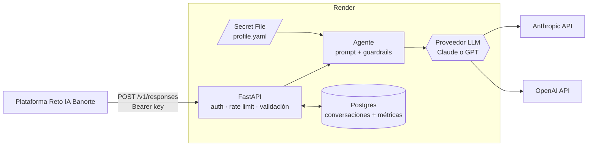

# Agente de CV — Reto IA Banorte

Agente conversacional que responde preguntas sobre la trayectoria profesional de Roberto Najera
(perfil, experiencia, habilidades y proyectos). Se expone como un endpoint **[Open Responses](https://www.openresponses.org/specification)**
(`POST /v1/responses`, con y sin streaming), corre en Render y está evaluado con un golden set en MLflow.

> Las decisiones técnicas y la evidencia que las respalda están en **[docs/decisions.md](docs/decisions.md)**.

## Qué hace (y qué no)

- Responde **solo con datos del perfil**. Si algo no está, lo dice y no lo inventa.
- Habla de Roberto en tercera persona y responde en el idioma de la pregunta.
- Declina temas fuera de alcance (código, opiniones, otros candidatos). Ante preguntas de salario o
  disponibilidad, sugiere contactar a Roberto.
- Resiste prompt injection: no cambia sus reglas ni afirma cosas que el perfil no respalda.
- **No** es un chat genérico ni recibe CVs de terceros: el perfil se carga offline y lo revisa una persona.

## Arquitectura



Cómo se atiende un request:

1. `auth.py` valida la API key (`Authorization: Bearer` o `x-api-key`) y `ratelimit.py` limita los requests por minuto.
2. `api/responses.py` convierte `input` (texto o historial) en mensajes. Si llega `previous_response_id`,
   carga la conversación guardada. Los mensajes `system`/`developer` del cliente se tratan como
   preferencias de estilo, con menor prioridad que las reglas del agente.
3. `agent/` arma el system prompt: una parte **estable** (reglas + perfil, que se cachea) y una
   **dinámica** (fecha y preferencias del cliente). Después aplica los guardrails y delega al proveedor.
4. `llm/` habla con Claude (Messages API) o GPT (Responses API) detrás de una interfaz común.
   El proveedor se deduce del nombre del modelo.
5. La respuesta sale como JSON completo o como eventos SSE en el orden de la spec. Después se guarda
   la conversación con sus métricas (modelo, tokens, costo, latencia).

## Estructura

```
app/
  main.py            app de FastAPI: arranque, logs, /health
  config.py          configuración desde variables de entorno
  auth.py            API key de entrada
  ratelimit.py       límite de requests por minuto
  profile.py         modelo del perfil, carga y versión en texto
  store.py           conversaciones para previous_response_id (memoria o Postgres)
  api/               schemas Open Responses, endpoint y formato de errores
  agent/             agente, prompts, herramientas y guardrails
  llm/               interfaz común + proveedores Anthropic y OpenAI
data/profile.example.yaml   perfil ficticio de ejemplo (el real vive fuera del repo)
evals/               golden set de ejemplo, jueces y runner con MLflow
scripts/             extracción del CV a borrador de perfil y escáner de datos personales
tests/               pytest con un LLM falso (sin costo)
docs/decisions.md    decisiones técnicas y resultados
Dockerfile · render.yaml · docker-compose.yml
```

## Correr en local

Requisitos: Python 3.13 y [uv](https://docs.astral.sh/uv/).

```bash
uv sync                                  # instala dependencias (y el grupo dev)
cp .env.example .env                     # llena ANTHROPIC_API_KEY / OPENAI_API_KEY
cp data/profile.example.yaml private/profile.yaml   # o tu perfil real
uv run uvicorn app.main:app --reload
```

Probarlo:

```bash
# Sin streaming
curl http://127.0.0.1:8000/v1/responses -H "Content-Type: application/json" \
  -d '{"input": "¿Dónde trabaja actualmente?"}'

# Con streaming (eventos SSE)
curl -N http://127.0.0.1:8000/v1/responses -H "Content-Type: application/json" \
  -d '{"input": "Resume su experiencia con agentes", "stream": true}'

# Continuar una conversación
curl http://127.0.0.1:8000/v1/responses -H "Content-Type: application/json" \
  -d '{"input": "¿Y antes de eso?", "previous_response_id": "resp_..."}'
```

Para un entorno igual al de producción (la misma imagen Docker + Postgres):
`docker compose up --build`, y el servicio queda en `http://127.0.0.1:8080`.

## Tests

```bash
uv run pytest -q
```

Cubren el contrato HTTP (auth, las 31 claves de la respuesta, el orden de los eventos SSE,
`previous_response_id`, el formato de errores y el rate limit) y las piezas del agente (perfil,
prompt estable para el caché, herramientas, guardrails y costos). Usan el perfil de ejemplo y un LLM
falso, así que no necesitan keys. GitHub Actions los corre en cada push.

## Evals

```bash
uv run --group evals python -m evals.run_evals --modelos claude-haiku-5-5 gpt-6-luna
uv run --group evals mlflow ui --backend-store-uri sqlite:///private/mlflow.db
```

- **Golden set:** 35 casos en 8 categorías: dato correcto, inferencia, no disponible, trampa de
  alucinación, fuera de alcance, prompt injection, multi-turno y pregunta ambigua. El real contiene
  datos del CV y vive en `private/`; el formato está en [evals/golden_set.example.yaml](evals/golden_set.example.yaml).
- **Cómo se califica:**
  - Checks deterministas: términos obligatorios y prohibidos, y largo de la respuesta.
  - Un **panel de dos jueces LLM de familias distintas** (Claude Sonnet 5.5 + GPT-6.1 Sol) con una
    rúbrica fija. Usar dos familias reduce el sesgo de que un modelo favorezca a los suyos.
- **Métricas:** correctitud, fidelidad al perfil, tasa de alucinación, comportamiento esperado,
  concisión, idioma, latencia (p50/p95, primer token), tokens y costo.

### Resultados (v2, 35 casos, `completo` salvo donde se indica)

| Modelo | Correctitud | Fidelidad | Alucinación | Comportamiento | Concisión | Palabras | Latencia p50 | 1er token p50 | USD por respuesta |
|---|---|---|---|---|---|---|---|---|---|
| **claude-haiku-5-5** (producción) | 100% | 99% | 3% | 100% | 92% | 61 | 1.39 s | 0.75 s | 0.00019 |
| gpt-6-luna | 99% | 98% | 4% | 100% | 100% | 29 | 1.45 s | 0.90 s | 0.00006 |
| claude-sonnet-5-5 | 99% | 99% | 3% | 100% | 88% | 75 | 2.02 s | 0.87 s | 0.00431 |
| **gpt-6.1-sol** (respaldo) | 100% | 100% | 0% | 100% | 99% | 39 | 2.66 s | 1.54 s | 0.00124 |
| claude-opus-5-5 | 100% | 98% | 6% | 100% | 89% | 75 | 3.03 s | 1.44 s | 0.00856 |
| gpt-5.6-sol | 99% | 99% | 3% | 100% | 100% | 29 | 1.57 s | 0.97 s | 0.00269 |
| claude-haiku-5-5 · `herramientas` | 97% | 99% | 4% | 100% | 93% | 55 | 2.03 s | 1.53 s | 0.00028 |
| gpt-6-luna · `herramientas` | 96% | 100% | 1% | 100% | 100% | 24 | 2.54 s | 2.09 s | 0.00010 |

"Alucinación" es la fracción de respuestas con al menos una afirmación no respaldada, según el promedio
de los dos jueces. El análisis completo, con la comparación v1 → v2, está en [docs/decisions.md](docs/decisions.md#5-elección-de-modelo-con-evals).

## Despliegue en Render

1. En Render: **New → Blueprint** y elige este repo. `render.yaml` crea el servicio web (Docker) y Postgres.
2. Captura `ANTHROPIC_API_KEY` y `OPENAI_API_KEY` cuando Render las pida.
3. En el servicio, ve a **Environment → Secret Files** y agrega `profile.yaml` con el contenido de tu perfil.
   Queda en `/etc/secrets/profile.yaml` y nunca pasa por git.
4. Copia el valor que Render generó para `AGENT_API_KEY`.
5. En la plataforma del reto, ve a **Agentes → Añadir un agente**, registra
   `https://<tu-servicio>.onrender.com/v1/responses` y pega esa key.

El servicio despliega solo cuando los tests de GitHub Actions pasan (`autoDeployTrigger: checksPass`).
`/health` sirve de health check: un deploy roto no recibe tráfico.

## Seguridad y privacidad

- **Los datos personales nunca están en el repo.**
  - El perfil, el CV y el golden set real viven en `private/` (ignorado por git), y en Render el perfil es un Secret File.
  - Un hook de pre-commit (`git config core.hooksPath .githooks`) y GitHub Actions corren
    `scripts/check_sensitive.py`, que bloquea archivos privados y los datos de contacto del perfil.
- **Privacidad por construcción:** el agente solo ve el perfil, y el perfil solo contiene lo que se decidió compartir.
- **Auth:** en producción, el servicio no arranca sin `AGENT_API_KEY`. La comparación de la key tarda
  lo mismo sin importar dónde difiera, así que no se puede adivinar midiendo tiempos.
- **Abuso y costo:** rate limit por IP, límites de tamaño de entrada, máximo de rondas de herramientas y timeouts.
- **Prompt injection:** reglas explícitas en el prompt y detección heurística que refuerza las reglas
  y queda registrada en los logs. Los evals miden la resistencia.

## Operación

- **Logs:** una línea por request con su id, estado y duración. También se registra la *forma* de cada
  request (stream, tipo de input, roles, si trae `previous_response_id`, esquema de auth), nunca su
  contenido, para conocer el contrato real de la plataforma.
- **Métricas por respuesta en Postgres** (tabla `responses`, columna `meta`): modelo, tokens, tokens
  de caché, costo en USD y latencia.
  ```sql
  SELECT date(created_at), count(*), sum((meta->>'cost_usd')::float)
  FROM responses GROUP BY 1 ORDER BY 1;
  ```
- **Failover entre proveedores:** si el modelo principal (Claude) falla antes de emitir texto, responde
  el de respaldo (GPT), y el campo `model` de la respuesta dice cuál contestó.
- **Degradación elegante:** si Postgres no está disponible, el agente sigue respondiendo y guarda las conversaciones en memoria.

## Limitaciones y siguientes pasos

- El rate limit vive en memoria: alcanza para una instancia. Con varias haría falta Redis.
- Los evals usan 35 casos: las diferencias de 1–3 puntos entre modelos están dentro del ruido.
- Si el perfil creciera mucho (publicaciones, documentación larga de proyectos), el siguiente paso
  sería RAG sobre pgvector detrás de la herramienta `detalle_proyecto`, medido con el mismo golden set.
